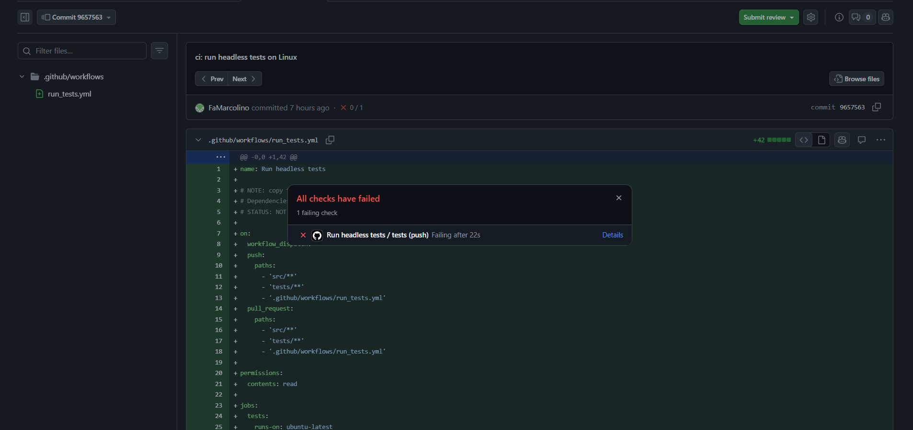
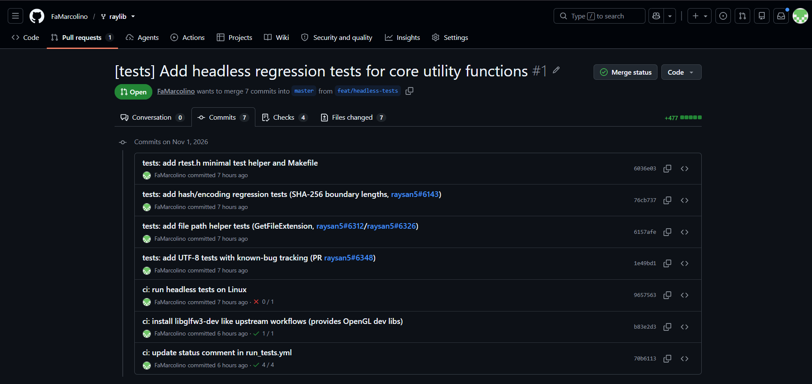
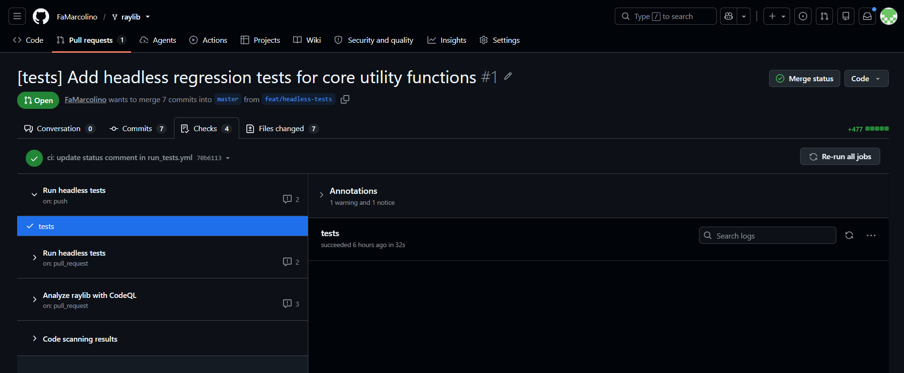

# 7 — Implementação experimental: testes de regressão headless

## O que foi implementado

| Arquivo | Função | Verificações |
|---|---|---|
| [`tests/rtest.h`](tests/rtest.h) | Mini-helper de testes (`CHECK`, `CHECK_INT`, `CHECK_STR`, `KNOWN_BUG`, `RUN`, `RTEST_SUMMARY`) | — |
| [`tests/test_hash.c`](tests/test_hash.c) | `ComputeSHA256/SHA1/MD5` em 14 comprimentos de fronteira, `ComputeCRC32`, Base64 (RFC 4648) | 65 |
| [`tests/test_paths.c`](tests/test_paths.c) | `GetFileName`, `GetFileExtension`, `IsFileExtension`, `GetFileNameWithoutExt`, `IsPathAbsolute` | 29 |
| [`tests/test_utf8.c`](tests/test_utf8.c) | `GetCodepoint` (válido/inválido/truncado), `GetCodepointCount`, `CodepointToUTF8` + teste de regressão do PR #6348 | 26 |
| [`tests/Makefile`](tests/Makefile) | `make test` (Windows/MSYS2, Linux, macOS) | — |
| [`ci/run_tests.yml`](ci/run_tests.yml) | Workflow de CI para copiar em `.github/workflows/` do fork | **executado no fork**: 1ª execução falhou, 2ª (com `libglfw3-dev`) verde |
| [`PR_DESCRIPTION.md`](PR_DESCRIPTION.md) | Texto do Pull Request | — |
| [`REVISAO.md`](REVISAO.md) | Roteiro/registro da revisão feita pelo outro integrante | **a preencher** |

**O MVP não altera nenhum arquivo de `src/`.**

## Como executar

Pré-requisitos: `gcc`/`clang` e `make` (Windows: MSYS2/UCRT64 → `mingw32-make`).

```bash
# na raiz do fork do raylib (a pasta tests/ é copiada para lá)
cd src
make PLATFORM=PLATFORM_DESKTOP            # gera src/libraylib.a   (Windows: mingw32-make ...)
cd ../tests
make test                                 # compila e roda os 3 testes
make clean
```

Windows/PowerShell (como foi feito aqui): `$env:PATH = "C:\msys64\ucrt64\bin;C:\msys64\usr\bin;" + $env:PATH` antes de chamar `mingw32-make`.
**Importante no Windows:** a pasta `C:\msys64\usr\bin` precisa estar no PATH porque o `make test` usa o `sh` do MSYS2. Sem ela, a compilação funciona,
mas o `make test` falha com `t foi inesperado neste momento` (o `mingw32-make` cai no cmd, que não entende o `for` do Makefile). Alternativa: usar o terminal "MSYS2 UCRT64".
A variável `RAYLIB_SRC` aponta para a pasta com `raylib.h` e `libraylib.a` (padrão `../src`):
`make RAYLIB_SRC=/caminho/para/src test`.

### Saída esperada (executada por nós, Windows 11, gcc 14.2.0 MSYS2)

```
=== test_hash ===
65 checks, 0 failed, 0 known bugs (XFAIL), 0 fixed known bugs (XPASS)
=== test_paths ===
29 checks, 0 failed, 0 known bugs (XFAIL), 0 fixed known bugs (XPASS)
=== test_utf8 ===
  (nenhuma linha XFAIL/XPASS: o PR #6348 já foi mesclado no raylib)
26 checks, 0 failed, 0 known bugs (XFAIL), 0 fixed known bugs (XPASS)
ALL TEST FILES PASSED
```

## Evidências de que os testes funcionam (e não só "passam")

### 1. Teste de mutação — o teste *detecta* um bug

Reintroduzimos, numa **cópia descartável** do `rcore.c`, um padding errado em `ComputeSHA256()`
(`paddedSize = dataSize + 4` no lugar de `dataSize + sizeof(bitLen)`, `rcore.c:3545`). Resultado:

```
sha256 len=56   MISMATCH     sha256 len=57  MISMATCH     sha256 len=59  MISMATCH
sha256 len=120  MISMATCH     sha256 len=121 MISMATCH
65 checks, 5 failed ...     exit code 1
```

Os comprimentos 0, 1, 3, 55, 60, 63, 64, 65 e 119 seguiram corretos — coerente com o bug real descrito em #6143 (`56..59 mod 64`).
**Limite honesto:** é uma mutação **nossa**, não o diff histórico do PR #6144; ela imita a classe do defeito.

### 2. Oráculo independente

Os valores esperados de SHA-256/SHA-1/MD5 foram gerados com **.NET `System.Security.Cryptography`** (não com o raylib) sobre a mensagem `'a' × N`;
CRC-32 usa o valor de verificação padrão `0xCBF43926` para `"123456789"`; Base64 usa os vetores da RFC 4648 §10.

### 3. Bug real documentado como `XFAIL` e depois promovido a `CHECK`

`test_utf8.c` registrou o problema do PR #6348 (aberto na época): para sequências truncadas (`"\xC3"`, `"\xE2\x82"`, `"\xF0\x9F\x98"`),
`GetCodepoint()` devolvia um tamanho maior que `strlen`, e na 1ª execução apareceram 3 `XFAIL`. O PR foi mesclado em 09/11/2026 (commit `7e626d65`); ao atualizar o fork em 10/11 a saída virou 3 `XPASS` — o aviso que o `rtest.h` foi feito para dar — e a verificação foi promovida a `CHECK`. Hoje é um teste de regressão comum (26 verificações, 0 XFAIL).

### 4. CI no GitHub Actions (prints)

Pull request no fork: https://github.com/FaMarcolino/raylib/pull/1

**1ª execução: falhou** (commit `9657563`). Faltava instalar `libglfw3-dev` no workflow (erro de link `cannot find -lGL`).



**Os 7 commits do PR #1.** O CI passa de ❌ (`9657563`) para ✅ após o commit `b83e2d3`, que instala `libglfw3-dev`.



**CI verde no PR #1** (testes e CodeQL).



> Observação sobre o CI: o `run_tests.yml` reaproveita as dependências do `build_linux.yml` do raylib. Foi executado no fork (aba *Actions*): a **1ª execução falhou** no passo
> "Run tests" (`exit code 2`) com o erro de link `/usr/bin/ld: cannot find -lGL`, porque o workflow não instalava `libglfw3`/`libglfw3-dev` (que trazem as bibliotecas de desenvolvimento do OpenGL);
> após incluí-los (commit `b83e2d3`), a execução ficou **verde**. Note que era falha de **build/link**, não de teste.
> Ou seja: comprovado em **Windows/MSYS2 (local)** e **Linux/Ubuntu (CI)**; macOS não foi testado. Anexem um print da execução verde na apresentação.
